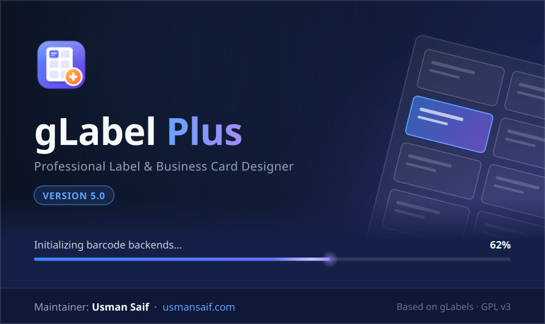
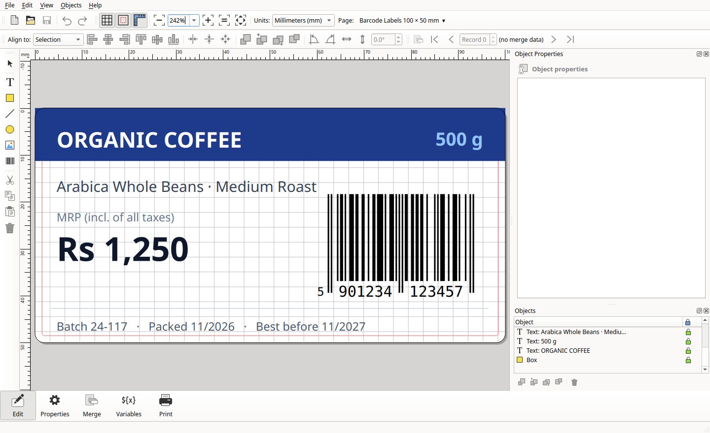
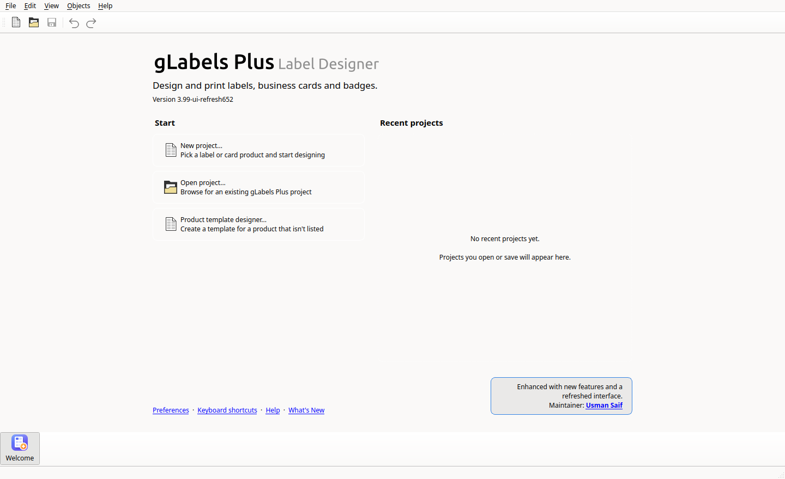
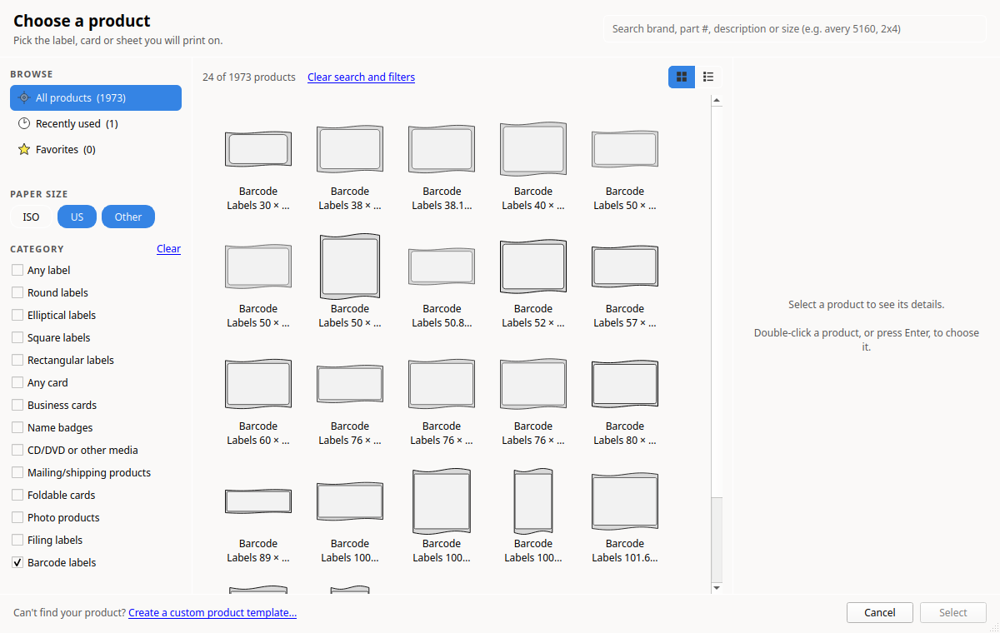
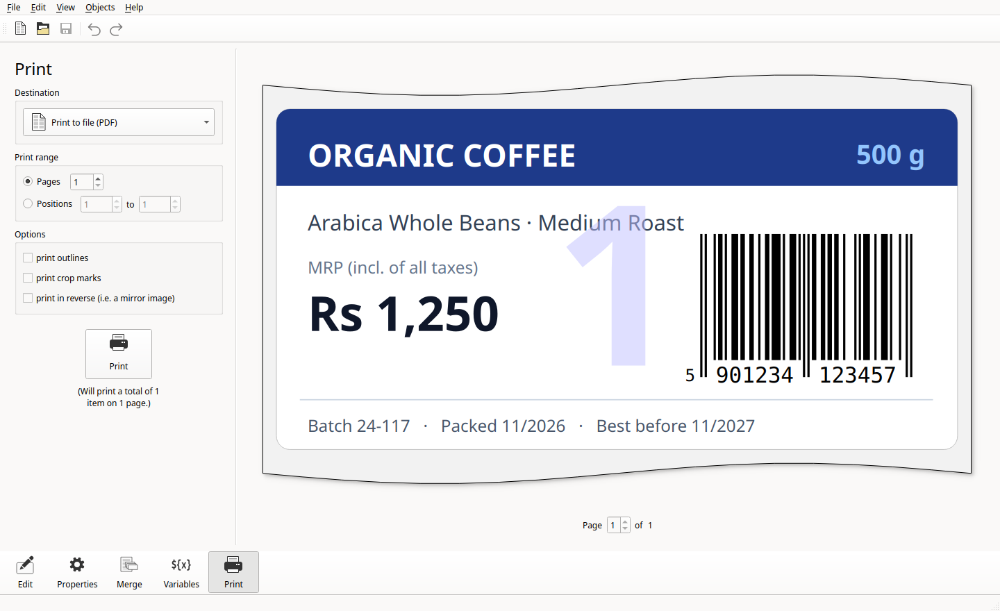
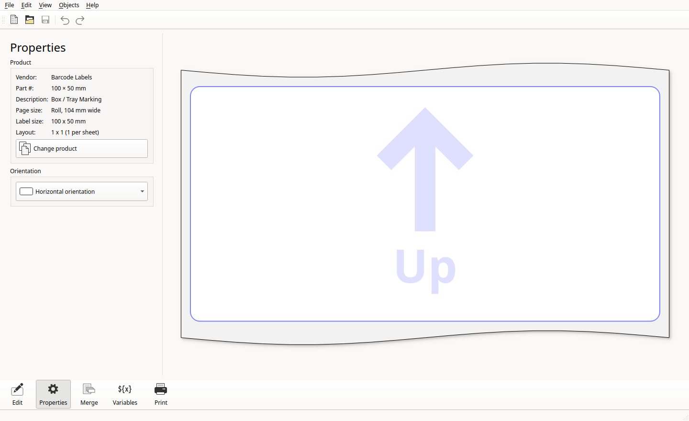
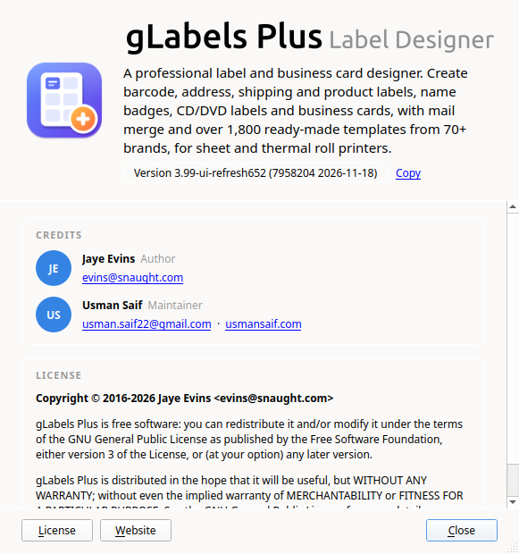
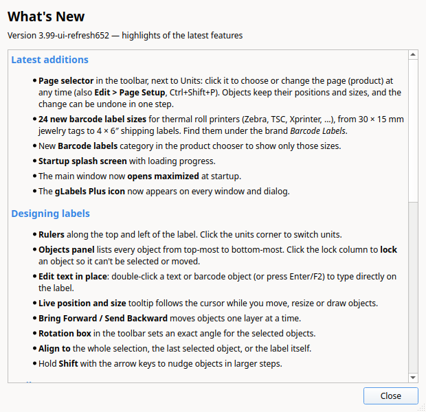
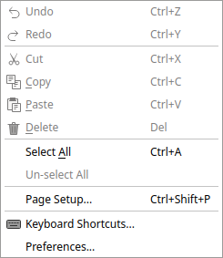

# gLabels Plus

**A professional label and business card designer for Linux, Windows and macOS.**

Design barcode, address, shipping and product labels, name badges, CD/DVD labels and
business cards, with mail merge and over 1,800 ready-made templates from 70+ brands, for
sheet printers and thermal roll printers.



gLabels Plus is built on [gLabels-qt](https://github.com/j-evins/glabels-qt) (gLabels 4) by
Jaye Evins. It adds a refreshed interface, faster ways to work, and new barcode label presets.

| | |
|:--|:--|
| **Version** | 5.0 |
| **Maintainer** | [Usman Saif](https://usmansaif.com) |
| **Original author** | Jaye Evins (gLabels) |
| **License** | GPL v3 or later |
| **Website** | <https://usmansaif.github.io/gLabels-plus/> |
| **Repository** | <https://github.com/usmansaif/gLabels-plus> |

*******************************************************************************

## Contents

- [Screenshots](#screenshots)
- [Features](#features)
- [What's new in this release](#whats-new-in-this-release)
- [Projects](#projects)
- [Barcode label presets](#barcode-label-presets)
- [Download](#download)
- [Building from source](#building-from-source)
- [Contributing](#contributing)
- [Credits](#credits)
- [License](#license)

*******************************************************************************

## Screenshots

### Label editor
Rulers, object list with locking, alignment tools, a rotation box, and the new **Page** selector
in the toolbar.



### Welcome screen and Projects
Quick actions, recent labels, and **Projects**: each business or client gets its own list of labels.



### Product chooser
Search by brand, part number, description or size, and filter by paper size and category.
The new **Barcode labels** category is shown here.



### Print and Properties

| Print preview | Label properties |
|:--:|:--:|
|  |  |

### About, What's New and the Edit menu

| About | What's New | Edit menu |
|:--:|:--:|:--:|
|  |  |  |

*******************************************************************************

## Features

### Designing labels
- **Text, barcodes, QR codes, images, boxes, lines and ellipses** on any label or card.
- **Rulers** along the top and left of the label. Click the corner to switch units.
- **Objects panel** that lists every object from top to bottom. **Lock** an object so it can't
  be selected or moved by accident.
- **Edit text in place**: double-click a text or barcode object, or press Enter/F2, and type
  straight onto the label.
- **Live position and size** tooltip that follows the cursor while you move, resize or draw.
- **Bring Forward / Send Backward** one layer at a time.
- **Rotation box** in the toolbar for exact angles.
- **Align to** the selection, the last selected object, or the label itself.
- Hold **Shift** with the arrow keys to nudge in larger steps.
- **Single-key tools**: V Select, T Text, R Box, L Line, O Ellipse, I Image, B Barcode, and
  E to erase (delete) the selection. Hover a toolbar button to see its key.
- **Quick font search**: type part of a font name in the Family box to filter the list, with each
  match shown in its own typeface.

### Projects
- **Group labels by business or client.** Each project has its own list of labels on the
  welcome screen. See [Projects](#projects).

### Pages and products
- **Page selector** in the toolbar, also available as **Edit > Page Setup** (Ctrl+Shift+P).
  Change the page at any time; every object keeps its position and size, and one undo reverts it.
- **Over 1,800 product templates** from Avery, Herma, Zweckform, Brother, Dymo, Uline, Worldlabel
  and many more.
- **24 barcode label presets** for thermal roll printers, in their own
  [Barcode labels](#barcode-label-presets) category.
- **Product chooser** with search, grid and list views, favorites, recently used products,
  and an *Also sold as* list of equivalent part numbers from other brands.
- **Product template designer** for products that aren't listed, including roll labels.

### Mail merge and variables
- Merge from **CSV and other text files**, with a **live merge preview** that shows real
  records on the label and First / Previous / Next / Last buttons.
- **User-defined variables** for counters, dates and other values that change from label to label.

### Printing
- **Sheet and continuous-roll** printing, with a print preview.
- **Click a label** in the preview to choose where printing starts on a partly used sheet;
  Shift+click to choose the last label.
- Optional **label outlines**, **crop marks** and **mirror printing**, with defaults in Preferences.
- **Print to PDF**.

### Workspace
- **Startup splash screen** with loading progress.
- Windows **always open maximized**.
- **Light and dark color schemes** and a choice of icon styles.
- **Redesigned Preferences** with a search box.
- **Custom keyboard shortcuts** for every menu command (Edit > Keyboard Shortcuts).
- Show or hide **toolbars and panels**, and choose icon size and text style.
- **Units selector** (in, mm, cm, pt, pc) and a zoom box that accepts typed values.
- The **gLabels Plus icon** on every window and dialog.

*******************************************************************************

## What's new in this release

- **Single-key tool shortcuts**: press **V** Select, **T** Text, **R** Box, **L** Line, **O** Ellipse,
  **I** Image, **B** Barcode and **E** to erase the selection. Toolbar tooltips show each key, and
  you can change them in **Edit > Keyboard Shortcuts**.
- **Quick font search**: type any part of a font name in the Family box to see matching fonts,
  previewed in their own typeface.
- **Projects**: keep each business or client's labels together. Create a project on the welcome
  screen (or **File > New Project**), then add as many labels to it as you need.
- **Page selector** in the toolbar, next to Units, and **Edit > Page Setup...** (Ctrl+Shift+P).
  Choose or change the page without moving any objects.
- **24 new barcode label sizes** for thermal roll printers (Zebra, TSC, Xprinter, Godex, ...),
  from 30 × 15 mm jewelry tags to 4 × 6″ shipping labels.
- New **Barcode labels** category in the product chooser.
- **Startup splash screen** with an animated loading bar.
- Windows **always open maximized**.
- **App icon** on every window and dialog.
- **About dialog** with a new product description and maintainer credit.

The full list is in **Help > What's New** inside the app.

*******************************************************************************

## Projects

Projects keep labels for different businesses or clients apart.

1. On the welcome screen, click **+ New project...** (or use **File > New Project...**) and type
   a name, such as *Coffee House* or *Northside Pharmacy*.
2. Select the project and click **New label...**. Choose a product, give the label a name, and it's
   saved straight into the project.
3. Click a label in the project's list to open it. Right-click for **Rename**, **Duplicate**,
   **Show in folder** and **Move to Trash**.
4. Right-click a project to **rename** it or **move it to the Trash**.

Each project is an ordinary folder in **Documents/gLabels Plus Projects/**, holding that project's
`.glabels` files. You can back it up, copy it to another computer, or share it like any other
folder, and changes made in your file manager show up in the app automatically.

*******************************************************************************

## Barcode label presets

All 24 sizes are listed under the brand **Barcode Labels** and the **Barcode labels** category.
Each preset is one label per page on a continuous roll, with 2 mm rounded corners and a 1.5 mm
safe-area guide. Width is across the print head and height is along the feed direction.

| Size (mm) | Size (in) | Typical use |
|:--|:--|:--|
| 30 × 15 | 1.18 × 0.59 | Mini / Jewelry Tag |
| 38 × 25 | 1.50 × 0.98 | Compact Retail & Stock |
| 38.1 × 25.4 | 1.50 × 1.00 | Compact Retail & Logistics |
| 40 × 30 | 1.57 × 1.18 | Healthcare & Asset Tag |
| 50 × 25 | 1.97 × 0.98 | Standard Retail / MRP |
| 50.8 × 25.4 | 2.00 × 1.00 | Compact Barcode Label |
| 50 × 30 | 1.97 × 1.18 | Product / Shelf Label |
| 50 × 50 | 1.97 × 1.97 | Square Retail / Product |
| 52 × 38 | 2.05 × 1.50 | Compact Shelf / Bin ID |
| 57 × 32 | 2.24 × 1.26 | Small Retail & Logistics |
| 60 × 40 | 2.36 × 1.57 | Mid-Size Warehouse / Retail |
| 76 × 38 | 2.99 × 1.50 | Courier & Warehouse |
| 76 × 50 | 2.99 × 1.97 | Stock Control & Packing |
| 76 × 51 | 3.00 × 2.00 | Inventory / Warehouse |
| 80 × 50 | 3.15 × 1.97 | Wide Product & Box ID |
| 89 × 28 | 3.50 × 1.10 | Address / Dymo 30252 |
| 100 × 50 | 3.94 × 1.97 | Box / Tray Marking |
| 100 × 100 | 3.94 × 3.94 | Pallet / Warehouse Tracking |
| 100 × 150 | 3.94 × 5.91 | Shipping & Courier (4×6) |
| 101.6 × 76.2 | 4.00 × 3.00 | Outer Box Logistics |
| 101.6 × 101.6 | 4.00 × 4.00 | Pallet / Location Square |
| 101.6 × 152.4 | 4.00 × 6.00 | Exact 4×6″ Zebra Shipping |
| 102 × 38 | 4.02 × 1.50 | Long Barcode / ID Strip |
| 102 × 50 | 4.02 × 1.97 | Carton & Inventory |

The definitions are in [templates/barcode-labels-templates.xml](templates/barcode-labels-templates.xml).

*******************************************************************************

## Download

Ready-to-run packages will be published on the
[Releases page](https://github.com/usmansaif/gLabels-plus/releases):

| Platform | Packages |
|:--|:--|
| Linux | `.AppImage`, `.deb`, `.rpm`, `.tar.gz` (Qt bundled) |
| Windows | `.exe` installer and portable `.zip` |
| macOS | `.dmg` and `.tar.gz` |

Until the first release is published, build from source as described below.

*******************************************************************************

## Building from source

### Quick start (Linux / macOS / Windows Git Bash)

```bash
git clone https://github.com/usmansaif/gLabels-plus.git
cd gLabels-plus
./build.sh --deps          # install build dependencies (first time only)
./build.sh                 # configure and build (Release)
./build/glabels/glabels-qt # run
```

Useful `build.sh` options:

| Option | Description |
|:--|:--|
| `-t, --type Debug` | Debug build (default: Release) |
| `-q, --qt PATH` | Use a specific Qt 6 install, e.g. `~/Qt/6.5.3/gcc_64` |
| `--install-qt 6.5.3` | Download Qt into `~/Qt` with aqtinstall and use it |
| `--test` | Run the unit tests after building |
| `--clean` | Delete the build directory first |

### Packaging

```bash
./release.sh                       # all package formats for this OS, written to dist/
./release.sh -f appimage,deb       # only some formats
```

### Requirements

- CMake 3.22+
- A C++20 compiler
- Qt 6.2+ (Core, Widgets, PrintSupport, Xml, Svg, Test)
- Optional: zlib, libqrencode, GNU Barcode, Zint

Detailed, platform-specific instructions:

- [Linux](dev-docs/BUILD-INSTRUCTIONS-LINUX.md)
- [Windows](dev-docs/BUILD-INSTRUCTIONS-WINDOWS.md)
- [macOS](dev-docs/BUILD-INSTRUCTIONS-MACOS.md)

*******************************************************************************

## Website

The project website is generated into `docs/` (served by GitHub Pages) from the page sources in
`website/pages/`. After editing a page, or the shared data in `website/build.py` (FAQ, barcode
presets, release notes), rebuild it with:

```bash
python3 website/build.py
```

*******************************************************************************

## Contributing

Bug reports, feature ideas and pull requests are welcome. Open an issue at
<https://github.com/usmansaif/gLabels-plus/issues>.

See also [dev-docs/CONTRIBUTING.md](dev-docs/CONTRIBUTING.md), [dev-docs/CODING-STYLE.md](dev-docs/CODING-STYLE.md)
and, for new product templates, [dev-docs/PRODUCT-TEMPLATES.md](dev-docs/PRODUCT-TEMPLATES.md).

*******************************************************************************

## Credits

- **Usman Saif** ([usmansaif.com](https://usmansaif.com)): maintainer of gLabels Plus.
- **Jaye Evins**: original author of gLabels and gLabels-qt.
- Everyone who has contributed code, translations and product templates to gLabels over the
  years. See [CREDITS.md](CREDITS.md).

*******************************************************************************

## License

gLabels Plus is free software: you can redistribute it and/or modify
it under the terms of the GNU General Public License as published by
the Free Software Foundation, either version 3 of the License, or
(at your option) any later version.

gLabels Plus is distributed in the hope that it will be useful,
but WITHOUT ANY WARRANTY; without even the implied warranty of
MERCHANTABILITY or FITNESS FOR A PARTICULAR PURPOSE.  See the
GNU General Public License for more details.

See [LICENSE](LICENSE) in this directory.

The following sub-components are also made available under less
restrictive licensing:

### Glbarcode

   gLabels Plus includes a version of the glbarcode++ library, located in
   the "glbarcode/" subdirectory.  It is licensed under the GNU LESSER GENERAL
   PUBLIC LICENSE (LGPL); either version 3 of the License, or (at your option)
   any later version.  See [glbarcode/LICENSE](glbarcode/LICENSE).

### Template Database

   The XML files in the "templates/" subdirectory constitute the glabels
   label database.  No copyright is claimed on the facts contained within
   the database and can be used for any purpose.  The files themselves are
   licensed using the MIT/X license.  See [templates/LICENSE](templates/LICENSE).
